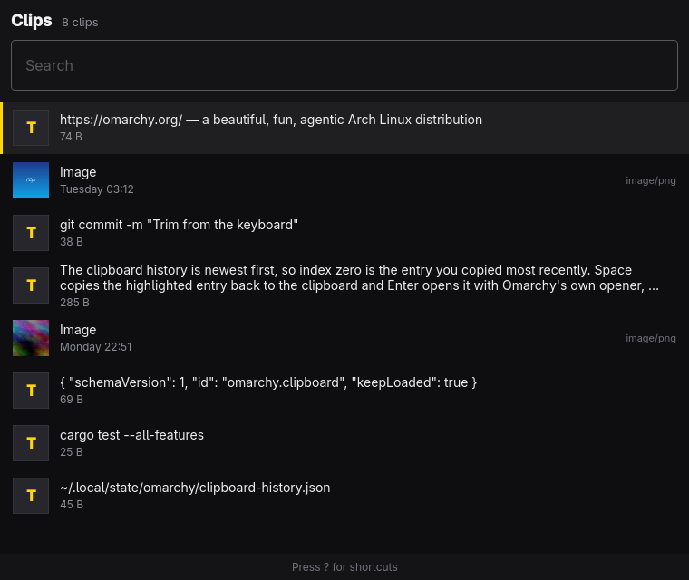

# Clips

Browse the Omarchy clipboard history and copy an entry back, from a quiet,
refined window that stays out of the way.



Clips reads the history the Omarchy shell already keeps at
`~/.local/state/omarchy/clipboard-history.json` — newest first, text and
images — and copies the highlighted entry back to the clipboard. It is
read-only: the shell owns the file, so Clips never writes to it.

## Shortcuts

| Key            | Action                              |
| -------------- | ----------------------------------- |
| `↑` `↓` / `J` `K` | Move the selection               |
| `g` / `G`      | Jump to the first / last entry      |
| `Space`        | Copy the highlighted entry          |
| `Enter`        | Open the highlighted entry          |
| `/` / `Ctrl+F` | Search                              |
| `Esc`          | Clear the search                    |
| `?`            | Show every shortcut                 |
| `Q`            | Quit                                |

Copy and Open are on screen next to the search box, each with its key shown on
the button; on a narrow window the keycaps step aside so search keeps its room.
The footer keeps the common keys visible, and `?` opens a grouped shortcut
sheet. Actions confirm in a floating pill, with errors in a different colour.

Copying a text entry puts it back on the clipboard with `wl-copy`; copying an
image puts the image back. Opening an entry hands it to Omarchy's own opener
(`omarchy-clipboard-open`), so a URL opens in the browser, text opens in the
editor, and an image opens in the snapshot viewer.

## Install

```sh
bin/install-user   # into ~/.local, no password
bin/install        # a system-wide Arch package, from a terminal
```

`bin/install-user` puts the binary in `~/.local/bin`, the icon in
`~/.local/share/icons`, and the launcher entry in
`~/.local/share/applications`, so Clips shows up in the Omarchy launcher
(`Super + Space`) without a password. `bin/install` builds the package in
`pkgbuild/` and installs it with `makepkg -fsi`, which needs root.

## Build and test

```sh
bin/build      # qmake6 + make into build/clips
bin/test       # the Qt Test binary, run offscreen, then the CLI checks
bin/test-cli   # just the CLI checks, with a fake wl-copy and opener
```

The window follows the Omarchy accent and Hyprland's window rounding live, and
the strings follow the language picked under Setup > Language (`src/i18n/`).

## From the command line

The same binary has a headless interface for scripts and AI agents. Any command
or command-line option skips the window entirely, and every command is read-only
with respect to the history file.

```sh
clips list [--limit N] [--json]   # newest first, text and images
clips search <query> [--json]     # filter the same list
clips latest [--json]             # only the newest clip
clips copy <index>                # put a clip back with wl-copy
clips open <index>                # open it with omarchy-clipboard-open
```

`--history <path>` works with every command, before or after it, so an agent can
inspect a saved snapshot without touching the live file. `--json` returns the
same fields every time: `count` plus `entries` of `index`, `time`, `type`, and
`preview`. Success exits 0; failure prints one line to stderr and exits non-zero.
Omarchy only stores a time for images, so `time` is an empty string for text
clips (shown as `—` in plain output).

`clips skill install` installs the bundled agent manual to
`~/.agents/skills/clips/SKILL.md` and links it into `~/.claude/skills/clips`
when `~/.claude` exists. `clips skill` prints the same manual without installing
it; `clips help [command]` lists the commands and their options.

## License

MIT. The project layout and the theme and translator classes follow Omacut and
Monologue (MIT, David Heinemeier Hansson), the templates Omarchy's
`omarchy-app` skill ships.
